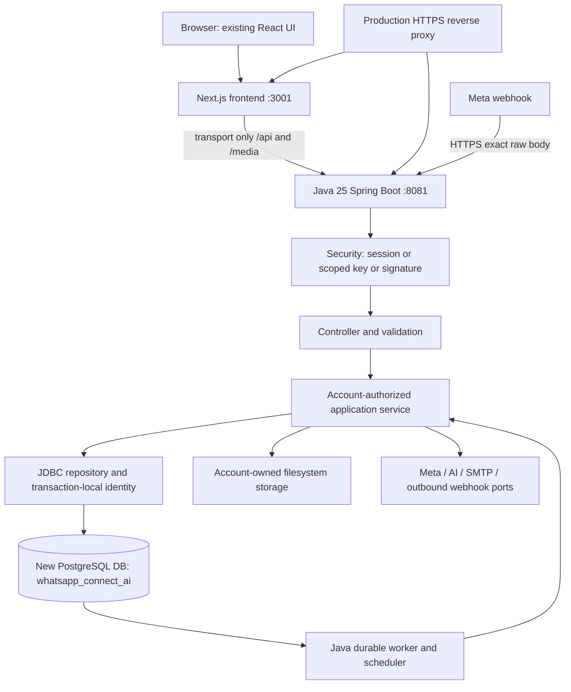

# Architecture and directory responsibilities

## Runtime flow



PostgreSQL and the filesystem are not exposed directly to the browser. Java owns
business logic. The original app on port 3000 is a comparison reference only.

## Proposed repository tree

```text
D:\whatsapp-connect-ai\
  README.md
  LICENSE                         # original MIT notice when code is copied
  .gitignore                      # private config/runtime/build exclusions
  frontend/                       # Next.js + React + TypeScript
    package.json / package-lock.json
    next.config.ts                # only rendering/configuration + API rewrites
    src/app/                      # existing page routes and layouts
    src/components/               # existing module UI
    src/hooks/                    # UI/polling hooks
    src/lib/api/                  # browser transport + CSRF + typed errors
    src/lib/auth/client.ts        # Java-auth adapter; no Better Auth runtime
    src/types/                    # frontend DTOs, generated where useful
    messages/ / public/
    tests/browser/
  backend/
    pom.xml / mvnw / mvnw.cmd / .mvn/
    src/main/java/com/whatsappconnect/
      WhatsAppConnectApplication.java
      configuration/              # explicit data sources, web, crypto, mail
      security/                   # filter chains, roles, CSRF, current identity
      shared/                     # narrow errors, clocks, IDs, redaction
      auth/                       # controllers/services/repos/DTOs within module
      account/ / dashboard/ / settings/
      contacts/ / inbox/ / whatsapp/ / templates/
      storage/ / pipelines/ / quickreplies/ / broadcasts/
      flows/ / automations/ / ai/ / notifications/
      publicapi/ / webhooks/ / jobs/ / apidocs/
    src/main/resources/
      application.yml             # safe defaults, environment placeholders
      application-local.yml
      db/migration/               # executable Flyway SQL, Java project only
    src/test/java/com/whatsappconnect/
    src/test/resources/            # fake provider fixtures; no real secrets
  database/
    bootstrap/                    # roles/database prerequisites, not app startup
    README.md                     # separate database, grants, migrations, backup
  scripts/                        # PowerShell helper commands, verification
  infra/                          # optional Docker/proxy deployment later
  docs/
    SPECIFICATION.md
    ARCHITECTURE.md
    DATABASE_AND_SECURITY.md
    MIGRATION_CHECKPOINTS.md
    MODULE_PARITY.md
    SETUP_AND_IDE.md
    STATUS.md
    checkpoints/                  # one evidence record for each completed gate
    reference/                    # old contract/schema/type inventories only
  local-data/                     # ignored uploads/mail; created at runtime
```

Only initial directories and specification/reference files exist at the document
checkpoint. The tree above names future files, not completed implementation.

## Module boundary rules

Each module owns controller, request/response records, application service,
repository and tests in its own package. Example: `contacts/ContactController.java`,
`ContactService.java`, `ContactRepository.java`, `ContactRequests.java`.

- Controllers parse/validate HTTP and map errors; they contain no SQL or provider calls.
- Services enforce account/role/business rules and define transaction boundaries.
- Repositories use named/parameterized SQL and receive trusted account context.
- Provider ports (`MetaClient`, `AiProvider`, `MailSender`, `MediaFetcher`) have
  real and test implementations. Do not mock account isolation with an all-powerful DB.
- Schedulers claim persisted work and invoke services; controllers do not own
  long-lived detached threads. Persist enough state to recover after restart.
- Use Java records for DTOs and sealed interfaces/enums for workflow node/step
  types when helpful. Keep JSON names and enum case compatible with the frontend.
- Avoid a giant shared utility package or one controller for the entire application.
- Do not add Maven submodules/microservices just to mirror folders.

## Main request and data flows

### Signup/login and authenticated page

1. Browser gets a CSRF token, posts signup/signin to Java through the same origin.
2. Signup atomically creates identity/credential/account/profile/defaults; failures
   roll back all provisioning. Email delivery must not falsely report success.
3. Signin authenticates, rotates session ID and stores session in PostgreSQL.
4. Browser receives an HttpOnly cookie. Java `GET /api/auth-context` resolves user,
   account and role; the existing auth hook adapts that response into UI context.
5. A later request validates the stored session and current membership again.
6. Signout invalidates the persisted session and expires the cookie. Back-button,
   reload and forged/stale cookies must not reveal protected data.

### Sending a WhatsApp message

1. Authorized agent submits the existing send payload.
2. Java verifies account ownership of conversation, contact, template and media.
3. Prepare durable send intent/correlation; load and decrypt the account token.
4. Call Meta with timeout, bounded response handling and redacted diagnostics.
5. Persist outcome/message and schedule internal follow-up work. An accepted send
   followed by a DB failure is not blindly resent. Record an unknown/reconcile state.
6. Polling updates the UI; status events reconcile delivered/read/failed state.

### Receiving messages

1. Public Java endpoint verifies HMAC over unchanged request bytes before parsing.
2. Store a bounded, authenticated inbound event in a durable queue; acknowledge
   only after commit. If persistence fails, respond with failure so Meta can retry.
3. Worker claims with lease/lock, resolves recipient Phone Number ID or template
   WABA ID to an account, applies existing deduplication and persists changes.
4. Dispatch existing flow/automation/AI/outbound-webhook behavior in source order.
   Preserve precedence and recursion guards; do not let all engines answer twice.
5. Browser polling reads new state. Worker failures retry with a bounded policy
   and visible dead-letter/recovery state, without duplicate customer messages.

### Waiting workflows

Persist cursor/node/step/variables and due time. Java scheduler claims due work
using database coordination; resumes in a transaction and records events. Test
restart, two concurrent worker processes, expired leases and cancelled/paused runs.
No old `npm run jobs` process is needed by the new backend.

## Error and contract rules

Retain existing dashboard versus public API envelopes and status variants.
Use stable error codes, appropriate HTTP status and request correlation IDs.
Do not leak SQL text, credentials or stack traces to clients. New auth endpoint
responses are explicit in the security design. Empty arrays, nulls, UTC timestamps,
UUIDs, numeric amounts, keyset cursors and multipart/raw upload formats need contract tests.

## Integration availability during migration

The entire existing frontend is a reference, not evidence that its APIs work.
Enable migrated modules only; show unfinished sections as unavailable. Cross-module
events use explicit interfaces and tests. Never route missing endpoints to the old
app or silently maintain two business backends in the target project.
